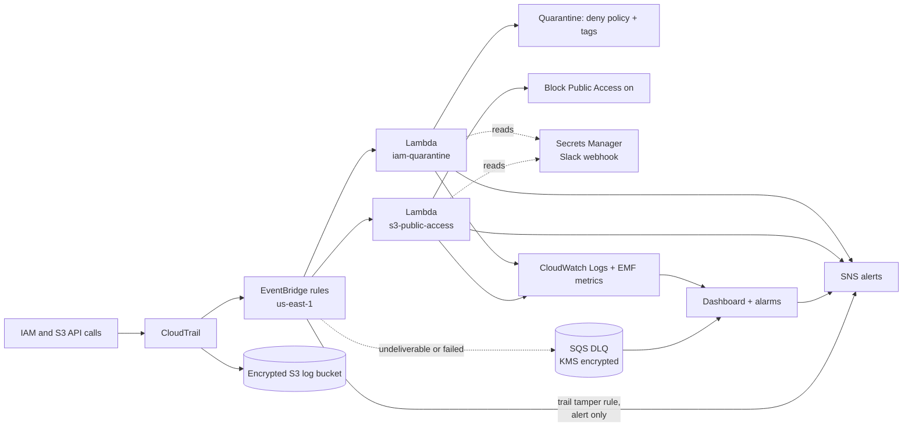

# Operation Sentinel

Cloud-native security automation for the fictional Aether Financial Services. A self-healing AWS
environment that detects, remediates, and audits two classes of misconfiguration the moment they happen.

> **TODO:** Why I built this.

## What it does

| Scenario | Control | Response |
|---|---|---|
| Over-privileged IAM role | `iam-quarantine` | Attaches an inline deny to protected roles that gain `*` on `*`, a service wide wildcard, or an open trust policy. Tags the role. Alerts with who, from where, and which event. |
| Public storage bucket | `s3-public-access` | Re-enables all four Block Public Access settings, tags the bucket, alerts. |

## Architecture



Everything encrypted at rest uses one customer managed KMS key: the trail, log groups, SNS topic,
DLQs and the Slack secret.

> **TODO:** AWS-Style Architecture Diagram

## Layers

| Layer | Where |
|---|---|
| Detection | `modules/responder` (EventBridge rule), event patterns in `modules/controls/*/main.tf`, trail tamper rule in `modules/audit-logging` |
| Remediation | `src/iam_quarantine`, `src/s3_public_access`, run by `modules/responder` |
| Observability | `modules/observability`, `src/sentinel_common/logging_utils.py` |
| Governance | `policies/` (OPA), `.checkov.yaml`, Trivy, `.github/workflows` |


## Layout

```
bootstrap/          one time: state bucket, KMS key, GitHub OIDC provider, plan and deploy roles
envs/dev/           root module that wires everything together
modules/
  kms/              one CMK for trail, logs, SNS, secrets
  audit-logging/    CloudTrail (multi region, log validation, S3 data events) and its log bucket
  alerting/         SNS topic and the (empty) Slack webhook secret
  responder/        reusable: Lambda, least privilege role, log group, DLQ, EventBridge rule
  controls/         iam-quarantine, s3-public-access
  observability/    alarms and the dashboard
  monitored-resources/  the test role and bucket the attack scripts target
src/                Lambda code (shared helpers plus one package per control)
policies/           OPA policies and their tests
tests/unit/         pytest, no AWS needed
tests/attack/       scripts that trigger each violation on purpose
docs/               design decisions, runbook, evidence
```

## Deploy

Prerequisites: Terraform or OpenTofu 1.11+, AWS credentials for a sandbox account, `us-east-1`.

```bash
# 1. Bootstrap (local state, once)
cd bootstrap
terraform init && terraform apply
terraform output -raw backend_hcl > ../envs/dev/backend.hcl

# 2. Platform
cd ../envs/dev
cp terraform.tfvars.example terraform.tfvars   # set alert_email and authorized_actor_arns
terraform init -backend-config=backend.hcl
terraform apply

# 3. Give Sentinel its Slack webhook (never goes through Terraform)
aws secretsmanager put-secret-value \
  --secret-id "$(terraform output -raw slack_secret_name)" \
  --secret-string '{"webhook_url":"https://hooks.slack.com/services/..."}'

# 4. Confirm the SNS subscription email right away. Skipping this causes recreate cycles on later applies.
```

Pipeline variables to set in GitHub (repository variables, not secrets):
`AWS_PLAN_ROLE_ARN`, `AWS_DEPLOY_ROLE_ARN`, `TF_STATE_BUCKET`, `TF_STATE_KMS_KEY_ARN`, `ALERT_EMAIL`,
and optionally `RELEASE_PRINCIPAL_ARNS` (a JSON list such as `["arn:aws:iam::<acct>:role/break-glass"]`,
default `[]`). PR plans and deploy plans read the same variables, so OPA judges the plan that ships.
Create a GitHub environment named `dev` with required reviewers.

## Prove it works

```bash
python -m pytest -q                         # unit tests, no AWS
bash tests/attack/01_iam_admin_star.sh      # expect SentinelQuarantineDenyAll
bash tests/attack/02_iam_rds_wildcard.sh    # expect the targeted deny
bash tests/attack/03_iam_trust_open.sh
bash tests/attack/04_s3_public.sh
bash tests/attack/05_trail_tamper.sh        # harmless UpdateTrail, expect an audit trail alert
bash tests/attack/99_release_and_reset.sh   # run as a release principal
```

Each script prints how many seconds Sentinel took. Capture results in `docs/evidence/`.

## Governance gates

Pull requests run: `terraform fmt`, `validate`, Checkov, Trivy, the unit tests, OPA policy tests, then a
read only `plan` whose JSON is checked by OPA (`policies/terraform.rego`). Deploys from `main`, in a
protected GitHub environment, rerun the unit tests and the OPA plan gate against the exact plan that
is then applied. The static scans already gated the pull request that changed `main`.

The OPA gate denies: `Allow *` on `*`, trust policies open to `*`, incomplete Block Public Access,
unencrypted SNS topics, SQS queues and log groups, log groups without retention, trails that are
single region or lack log file validation, Lambdas without a DLQ or active tracing, secret-looking
Lambda environment values, and any `aws_secretsmanager_secret_version`. It warns on service-wide
wildcards, and on IAM policies that are unknown until apply.

## Design decisions and limits

See [docs/design-decisions.md](docs/design-decisions.md) and [docs/runbook.md](docs/runbook.md).

